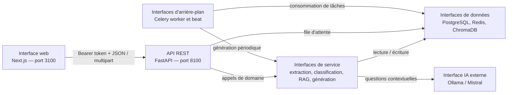

# SmartWork AI MVP — Guide de spécification fonctionnelle

Ce guide décrit le contrat d'utilisation du système : ce que chaque interface expose, ce qu'elle garantit, et comment les interfaces coopèrent. Il ne décrit pas l'implémentation interne — celle-ci est consultable dans `documentation.md` et dans le code source.

## 1. Périmètre du système

SmartWork AI MVP est une application multiorganisation de gestion documentaire assistée par IA. Elle couvre six chaînes de valeur :

1. Authentification et apprentissage du compte.
2. Dépôt et extraction de documents.
3. Analyse, classification et indexation.
4. Génération de livrables (synthèse, DOCX, XLSX, PDF, PPTX).
5. Planification et publication de rapports.
6. Suivi opérationnel des tâches, dialogue IA et analytique.

Le système expose quatre surfaces d'interaction distinctes : l'interface web, l'API REST, les interfaces de service internes, et les interfaces d'infrastructure. Chaque surface a un rôle propre et une frontière de responsabilité explicite.

## 2. Cartographie des interfaces



### 2.1 Interface web (Next.js)

L'interface web est une application App Router. Toutes les routes authentifiées passent par `frontend/components/app-shell.tsx`, qui porte la navigation latérale, le contrôle de session et la déconnexion. Les pages publiques `/login` et `/inscription` contournent ce shell.

| Route | Responsabilité | Appels API principaux |
|---|---|---|
| `/login` | Authentification d'un utilisateur existant. | `POST /api/v1/auth/login` |
| `/inscription` | Création d'un compte et de son organisation. | `POST /api/v1/auth/register` |
| `/dashboard` | Vue synthétique des tâches et documents. | `GET /api/v1/tasks/dashboard/overview` |
| `/documents` | Dépôt, liste, détail et correction de classification. | `POST /api/v1/documents/upload`, `GET /api/v1/documents`, `GET /api/v1/documents/{id}`, `PATCH /api/v1/documents/{id}/classification` |
| `/chat` | Dialogue avec le corpus autorisé. | `POST /api/v1/chat/send`, `GET /api/v1/chat/history` |
| `/generation` | Production et historique des livrables. | `POST /api/v1/generation/summary/{id}`, `/docx`, `/xlsx`, `GET /api/v1/generation/history` |
| `/planning` | Gestion des plannings de rapports. | `GET`/`POST /api/v1/reporting/schedules`, `PUT`/`DELETE /api/v1/reporting/schedules/{id}` |
| `/suivi` | Tableau Kanban des tâches. | `GET`/`POST /api/v1/tasks/`, `PATCH /api/v1/tasks/{id}/status` |
| `/settings` | Information de compte et déconnexion. | Aucun appel ; suppression du jeton local |

Contrat de session : le jeton d'accès est conservé dans `localStorage` et transmis par `frontend/lib/api.ts` sous la forme `Authorization: Bearer <token>`. Une réponse `401` ramène l'utilisateur vers `/login`. La protection des routes est côté client ; le serveur reste la source de vérité via ses dépendances d'authentification.

La route `/` conserve le contenu par défaut du modèle Next.js. Elle ne fait pas partie du parcours métier et constitue un écart connu, détaillé au chapitre 8.

### 2.2 Interface API REST (FastAPI)

L'application monte les routeurs sous `/api/v1`. Les endpoints racines `GET /` et `GET /health` sont publics. Tout autre endpoint métier exige un jeton valide, à l'exception de `POST /api/v1/auth/register` et `POST /api/v1/auth/login`.

| Domaine | Préfixe | Opérations exposées |
|---|---|---|
| Authentification | `/auth` | Inscription, connexion, émission d'un JWT. |
| Documents | `/documents` | Dépôt, liste, détail, correction de classification, téléchargement, suppression. |
| Dialogue | `/chat` | Envoi de question, historique, lecture d'une conversation, signalement d'une réponse incorrecte. |
| Génération | `/generation` | Synthèse, DOCX, XLSX, PDF, PPTX, téléchargement de fichier, historique. |
| Rapports | `/reporting` | CRUD des plannings, génération manuelle ou forcée, historique, statut, validation, publication, notification par courriel. |
| Tâches | `/tasks` | Création, liste, lecture, changement de statut, commentaires, agrégats du tableau de bord. |
| Analytique | `/analytics` | Profilage d'un document, calcul de KPI (somme, moyenne, conversion, croissance), génération de graphique, tableau de bord analytique. |

L'API constitue la frontière contractuelle du système : tout ce que peut faire un client web peut être reproduit par un client HTTP muni d'un jeton valide. La documentation interactive est servie par Swagger UI sur `/docs`.

### 2.3 Interfaces de service internes

Ces interfaces ne sont pas exposées directement ; elles sont appelées par les routeurs et par les tâches asynchrones.

| Interface | Contrat fonctionnel |
|---|---|
| `services/ingestion.py` | Valide le fichier (taille, extension, type MIME, nom), le stocke, crée `Document` et `DocumentVersion`, résout les organisations de l'utilisateur. |
| `services/extraction.py` | Route vers l'extracteur adapté au format (DOCX, XLSX, CSV, PDF), normalise texte, tableaux et segments, active l'OCR lorsque un PDF contient trop peu de texte. |
| `services/classification.py` |Attribue une catégorie et un score de confiance au texte extrait. |
| `services/embedding.py` | Calcule des vecteurs de texte et de requête, et la similarité cosinus. Le modèle se charge paresseusement ; l'absence de dépendance désactive proprement la fonction. |
| `services/rag/rag_pipeline.py` | Détermine le périmètre autorisé, récupère les segments pertinents, applique si disponible un mix lexical et vectoriel, construit le contexte, interroge Ollama, et produit une réponse avec citations ou une réponse extractive de repli. |
| `services/generation.py` | Produit les livrables à partir des données extraites et persiste un `GeneratedFile`. |
| `services/notifications.py` | Dépose les événements de tâches dans des listes Redis, sans bloquer l'appelant. |
| `reporting/tasks.py` | Génère les rapports journaliers, hebdomadaires et mensuels, applique l'idempotence Redis et crée les brouillons de rapport. |
| `analytics/kpi_calculator.py` | Calcule les KPI et construit les figures Plotly consommées par l'API analytique. |

### 2.4 Interfaces de données et d'infrastructure

| Interface | Rôle | Point d'accès |
|---|---|---|
| PostgreSQL | Données métier et audit. | `db:5432`, publié en `5442`. |
| Redis | File Celery, cache, notifications, verrous d'idempotence. | `redis:6379`, publié en `6390`. |
| ChromaDB | Magasin vectoriel pour la récupération sémantique. | `chroma:8000`, publié en `8101`. |
| Ollama | Inférence du modèle Mistral. | `ollama:11434`, publié en `11444`, profil `ai`. |
| Celery worker | Exécution des tâches asynchrones. | Réseau `data`. |
| Celery beat | Déclenchement périodique des rapports. | Réseau `data`. |
| Redis Commander | Inspection Redis, profil `tools`. | `8181`. |

Les migrations Alembic sont exécutées par le service `migrate` avant le démarrage de l'API. Les réseaux Docker `frontend` et `data` séparent le trafic client du trafic de données.

## 3. Modèle de sécurité et de périmètre

L'authentification repose sur un JWT signé avec `SECRET_KEY` selon l'algorithme `HS256`, avec une durée de vie de 30 minutes. Les mots de passe sont hachés avec bcrypt. La dépendance `get_current_user` résout l'utilisateur à partir du champ `sub` du jeton.

Le périmètre d'accès aux données est déterminé par l'appartenance de l'utilisateur à une ou plusieurs organisations. Un document, un rapport ou une tâche n'est visible que si son propriétaire ou son organisation correspond à ceux du jeton. Le pipeline RAG applique le même périmètre avant toute récupération : un utilisateur ne peut interroger que ses propres documents.

Les actions sensibles — dépôt, suppression, correction de classification, changement de statut, signalement de réponse, validation et publication de rapport — sont enregistrées dans `AuditLog`.

Limite actuelle : le contrôle par rôle reste minimal. Le champ `role` existe sur `User`, mais aucune politique fine n'est appliquée en aval. Ce point est traité dans les perspectives.

## 4. Parcours fonctionnels complets

### 4.1 Création de compte et connexion

1. Le client envoie `email`, `password` et `organization_name` à `/api/v1/auth/register`.
2. Le serveur crée l'organisation, hache le mot de passe, crée l'utilisateur et retourne un JWT.
3. Le client stocke le jeton et accède à `/dashboard`.
4. Sur connexion ultérieure, `/api/v1/auth/login` vérifie les identifiants et émet un nouveau jeton.

Le client doit joindre le jeton à chaque appel suivant. Sans jeton valide, le serveur refuse la requête.

### 4.2 Dépôt et traitement d'un document

1. L'utilisateur sélectionne un fichier CSV, XLSX, DOCX ou PDF dans `/documents`.
2. `POST /api/v1/documents/upload` reçoit un `multipart/form-data`.
3. `validate_file` refuse les extensions non autorisées, les fichiers vides et les dépassements de taille.
4. `save_upload` écrit le fichier dans le stockage et crée `Document` et `DocumentVersion`.
5. `extract_document` produit texte, tableaux, métadonnées et segments. Pour un PDF pauvre en texte, l'OCR est appliqué automatiquement.
6. `classify_document` attribue une catégorie et une confiance.
7. Les segments deviennent des `DocumentChunk` ; les données structurées sont stockées dans `ExtractedData`.
8. Le document passe au statut `processed` ou `needs_review` selon le résultat.

La page `/documents` affiche ensuite le texte, les tableaux, les segments et la provenance. L'utilisateur peut corriger la classification ; cette correction est auditable. La suppression retire le document, ses données dérivées et ses fichiers.

### 4.3 Dialogue assisté par IA

1. L'utilisateur pose une question depuis `/chat`.
2. `POST /api/v1/chat/send` transmet la question, l'historique utile et l'identifiant de conversation.
3. Le détecteur d'injection analyse la question. Si une tentative est reconnue, la réponse est refusée et l'événement est journalisé.
4. `identify_scope` calcule les documents autorisés pour l'utilisateur.
5. `retrieve_authorized` sélectionne les segments pertinents. Le repli lexical fonctionne toujours ; le complément vectoriel s'active uniquement si les embeddings sont disponibles.
6. Le contexte est tronqué pour tenir dans la fenêtre du modèle.
7. Si Ollama répond, le texte est synthétisé avec citations. Sinon, `_extractive_answer` construit une réponse à partir des segments récupérés.
8. La réponse, les citations, le drapeau `fallback` et le drapeau `used_llm` sont retournés et conservés dans `Conversation`.
9. Le bouton de signalement alimente `POST /api/v1/chat/report` pour analyse de la qualité.

Le contrat promet une réponse sourcée et un périmètre respecté. Il ne promet pas une génération LLM disponible dans tous les environnements : le repli extractif fait partie du comportement normal.

### 4.4 Génération de livrables

1. Depuis `/generation`, l'utilisateur choisit un document et un type de livrable.
2. `/generation/summary/{id}` produit une synthèse textuelle.
3. `/generation/docx`, `/generation/xlsx`, `/generation/pdf` et `/generation/pptx` produisent des fichiers à partir des données extraites.
4. Chaque production crée un `GeneratedFile` avec son chemin, son format et son statut.
5. `GET /generation/file/{id}` télécharge le fichier et le marque comme validé.
6. `GET /generation/history` alimente le tableau d'historique de la page.

Les formats DOCX et XLSX sont ceux exposés dans l'interface actuelle. Les routes PDF et PPTX existent côté API et nécessitent une validation de bout en bout avant d'être présentées comme stables.

### 4.5 Planification et publication de rapports

1. `/planning` crée un `ReportSchedule` : organisation, propriétaire, fréquence, fuseau horaire, paramètres et destinataires.
2. La liste des plannings est lue avec `GET /reporting/schedules`.
3. `PUT /reporting/schedules/{id}` active ou désactive un planning ; `DELETE` le retire.
4. `POST /reporting/schedules/{id}/generate?force=true` déclenche une génération immédiate.
5. `POST /reporting/generate` lance une génération ponctuelle sans planning.
6. `GET /reporting/history` et `GET /reporting/{id}/status` suivent l'avancement.
7. `POST /reporting/{id}/validate`, `/publish` et `/email-notify` couvrent le cycle de validation, publication et notification.
8. En parallèle, Celery beat déclenche les rapports journaliers, hebdomadaires et mensuels. Les clés d'idempotence Redis empêchent les doublons.

### 4.6 Suivi des tâches

1. `/suivi` charge les tâches avec `GET /api/v1/tasks/`.
2. La création passe par `POST /api/v1/tasks/?title=...&due_date=...`.
3. `PATCH /api/v1/tasks/{id}/status?new_status=...` fait évoluer le statut ; `PATCH /api/v1/tasks/{id}/comments` ajoute un commentaire.
4. Chaque transition déclenche une notification Redis et une entrée d'audit.
5. `GET /api/v1/tasks/dashboard/overview` alimente les indicateurs du tableau de bord.

Les colonnes du tableau correspondent aux statuts : à faire, en cours, en révision, terminé, échoué. Un utilisateur ne modifie que les tâches de son périmètre.

### 4.7 Analytique

Les endpoints `/analytics` travaillent sur les données structurées issues de l'extraction. Le profilage décrit un document ; les opérations `sum`, `avg`, `conversion` et `growth` calculent des KPI ; `chart/generate` construit une figure ; `dashboard/{id}` agrège le résultat. Chaque appel vérifie l'accès au document avant lecture.

Ce domaine est le plus dépendant de la forme réelle des données extraites. Il doit être considéré comme en cours de consolidation.

## 5. Contrats de données métier

Les entités porteuses du parcours sont les suivantes :

| Entité | Contrat fonctionnel |
|---|---|
| `Organization` | Périmètre d'appartenance et de multiorganisation. |
| `User` | Identité, identifiants, rôle et appartenances. |
| `Document` | Fichier source, statut de traitement, classification. |
| `DocumentVersion` | Historique des versions du fichier stocké. |
| `DocumentChunk` | Segment indexable avec position et métadonnées. |
| `ExtractedData` | Données structurées et provenance de l'extraction. |
| `Conversation` | Échange IA, contexte et résumé. |
| `GeneratedFile` | Livrable produit, format, chemin et statut de validation. |
| `Report` | Rapport généré, son état et ses métadonnées. |
| `ReportSchedule` | Fréquence, fuseau, paramètres, destinataires et activation. |
| `Task` | Travail suivi, statut, échéance, assignation et commentaires. |
| `AuditLog` | Trace des actions sensibles. |
| `Notification` | Événement diffusé à un utilisateur. |

Une règle transversale s'applique : toute entité métier rattachée à une organisation doit être lue et modifiée dans le périmètre de cette organisation.

## 6. Démarrage et vérification

Le démarrage de référence est le suivant :

```bash
cd /home/laura/SmartWorkAI_MVP
docker compose up -d
docker compose exec backend python -m pytest tests -q
```

Les points de contrôle sont :

- `GET http://localhost:8100/health` répond.
- `http://localhost:8100/docs` affiche les opérations de l'API.
- `http://localhost:3100/login` permet de se connecter.
- Le service `ollama` doit être démarré explicitement lorsqu'il utilise le profil `ai` : `docker compose --profile ai up -d ollama`.
- Redis Commander est disponible avec le profil `tools`.

Les tests présents couvrent le chemin critique upload → extraction → classification → chat avec citations, l'isolation organisationnelle, la détection d'injection, la correction de classification, le rejet d'extension invalide, ainsi que l'extraction CSV, DOCX, XLSX et PDF.

## 7. Configuration requise

| Variable | Rôle | Valeur de référence |
|---|---|---|
| `SECRET_KEY` | Signature des jetons. | Valeur aléatoire longue, imposée en production. |
| `DATABASE_URL` | Connexion PostgreSQL. | `postgresql://smartwork:smartwork@db:5432/smartwork` |
| `REDIS_URL` | File et cache. | `redis://redis:6379/0` |
| `OLLAMA_HOST` | Endpoint d'inférence. | `http://ollama:11434` |
| `OLLAMA_MODEL` | Modèle utilisé. | `mistral` |
| `CHROMA_HOST` / `CHROMA_PORT` | Magasin vectoriel. | `chroma` / `8000` |
| `BACKEND_PORT` / `FRONTEND_PORT` | Publication hôte. | `8100` / `3100` |

Les répertoires de stockage `STORAGE_DIR`, `UPLOAD_DIR`, `GENERATED_DIR` et `LOG_DIR` sont créés au démarrage de l'application. La taille maximale d'un envoi est définie par `MAX_UPLOAD_SIZE_MB`.

## 8. Limites connues

Ces points ne remettent pas en cause le contrat fonctionnel, mais ils conditionnent l'exploitation du MVP :

- La page `/` reste le modèle par défaut de Next.js et n'est pas une accueil métier.
- La protection des routes web est côté client ; la sécurité réelle repose sur l'API.
- Le modèle `sentence-transformers` peut être absent : la récupération vectorielle se désactive alors et le repli lexical prend le relais.
- Ollama peut être indisponible ou en cours de chargement : le repli extractif garantit une réponse sourcée.
- `backend/app/models/__init__.py` et `backend/app/db/session.py` définissent chacun une configuration de base de données. Cette duplication doit être résorbée.
- `services/generation.py` contient plusieurs variantes de génération PDF. Une unification est nécessaire avant de figer l'API.
- Certains endpoints analytiques supposent une forme de données extraite précise et restent fragiles.
- Les documents `docs/requirements-traceability.md` et `docs/gap-analysis.md` ne sont pas alignés : la traçabilité annonce des éléments terminés que l'analyse d'écarts déclare instables.
- Le contrôle par rôle n'est pas encore appliqué finement.

## 9. Perspectives d'évolution

### 9.1 Court terme — fiabilisation

1. Remplacer la page `/` par un tableau de bord productif avec accès direct aux six parcours.
2. Unifier la configuration de session base de données en une seule source.
3. Consolider les fonctions de génération PDF et clarifier quels formats sont officiellement supportés.
4. Aligner `requirements-traceability.md` et `gap-analysis.md` sur l'état réel du code.
5. Renforcer le chemin critique : réponse sourcée stable même avec Ollama froid, et tests de non-régression sur chaque endpoint.
6. Corriger les endpoints analytiques fragiles et focaliser les KPI sur des formats de données garantis.

### 9.2 Moyen terme — robustesse et gouvernance

1. Introduire une politique RBAC explicite : administrateur, gestionnaire, lecteur, avec contrôle côté serveur.
2. Déplacer la garde des routes côté serveur et conserver le jeton dans un cookie sécurisé plutôt que dans `localStorage`.
3. Ajouter la journalisation structurée, des traces distribuées et des métriques par endpoint.
4. Étendre la couverture de tests aux rapports planifiés, à la publication et aux notifications.
5. Ajouter une file de révision humaine pour les documents `needs_review` et les réponses IA signalées.
6. Versionner les modèles de génération et les modèles de classification pour garantir la reproductibilité des livrables.

### 9.3 Long terme — plateforme

1. Multiorganisation avancée avec politiques de rétention et cloisonnement renforcé.
2. Support multilingue pour l'interface, l'OCR et la synthèse IA.
3. Connecteurs sortants : courriel, Slack, stockage externe, webhooks.
4. RAG enrichi : reranking, citations au niveau de la phrase, détection de contradictions entre sources.
5. É valuation continue de la qualité des réponses à partir des signalements utilisateurs.
6. Conformité et gouvernance : chiffrement au repos, gestion des consentements, export et suppression RGPD.
7. Passage d'un monolithe modulaire à des services séparés uniquement lorsque la charge et les équipes le justifient.

## 10. Lecture recommandée

- Pour l'architecture, les schémas et la configuration : `docs/documentation.md`.
- Pour les décisions structurantes : `docs/adr/001-modular-monolith.md`, `002-tech-stack.md`, `003-rag-pipeline.md`.
- Pour le modèle relationnel : `docs/erd-diagram.md`.
- Pour l'état des exigences : `docs/requirements-traceability.md` et `docs/gap-analysis.md`.
- Pour l'implémentation : le code source sous `backend/app/` et `frontend/app/`.
